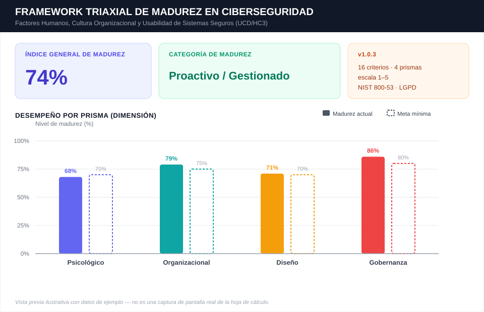

# 🛡️ Triaxial Cybersecurity Maturity Framework

<p align="left">
  
  
  
  
  <a href="https://doi.org/10.5281/zenodo.21986801"></a>
</p>

<p align="left">
  
  
  
  
</p>

**🌐 Leer en otro idioma:** [English](README.md) · [Português (BR)](README.pt-BR.md) · **Español**

> **Instrumento auditable y cuantitativo** para medir la madurez de ciberseguridad desde la perspectiva del factor humano, derivado del artículo *"Human Factors in Cybersecurity: A Triaxial Analysis from the Psychological, Organizational, and Design Perspectives, with an Extended Governance-Oriented Maturity Assessment Instrument"* (Santos, Silva & Florindo, PPEE/UnB).

---

## 📖 Sobre el Framework

Diversos estudios indican que **más del 95%** de los incidentes cibernéticos involucran, en algún nivel, error o manipulación humana. A pesar de ello, la mayoría de las organizaciones mide su postura de seguridad de forma puramente técnica o mediante *reach metrics* (cuántas personas "vieron la capacitación"), sin ninguna métrica objetiva de efectividad.

Este repositorio pone a disposición la hoja de cálculo **[`framework-triaxial-madurez-ciberseguridad.xlsx`](framework-triaxial-madurez-ciberseguridad.xlsx)** — la versión completamente en español de la hoja de cálculo original `cybersecurity-maturity-framework.xlsx` (hojas, encabezados, criterios y mensajes de validación traducidos) — que operacionaliza el **Modelo Triaxial** (Psicológico, Organizacional y de Diseño) descrito en el artículo, extendido con un **cuarto prisma de Gobernanza y Cumplimiento** (NIST SP 800-53 y LGPD), dando como resultado un instrumento de **16 criterios de evaluación, agrupados en 4 dimensiones**, con pesos y fórmulas ponderadas que generan un **Índice General de Madurez (Imat)** y una clasificación organizacional automática.

| Prisma | Enfoque | Referencia clave |
|---|---|---|
| 🧠 **Psicológico** | Amygdala hijacking, sesgo de automatización, alfabetización digital, phishing | Hadlington (2017); Hagen et al. (2025); Anwar et al. (2017) |
| 🏢 **Organizacional** | Paradoja conocimiento‑comportamiento, efectividad de CSA vía CTI, inteligencia integrada, notificación de incidentes | Georgiadou et al. (2022); Silva et al. (2025) |
| 🎨 **Diseño** | Framework HC3, carga cognitiva, *security by design*, gobernanza de BYOD/Shadow IT | Cristiano & Spadafora (2024); Gutzwiller & Van Bruggen (2021) |
| ⚖️ **Gobernanza y Cumplimiento** | Controles NIST SP 800‑53, principios de la LGPD, notificación al CTIR Gov, OSINT antifraude | NIST SP 800‑53 Rev. 5; LGPD (Ley n.º 13.709/2018) |

---

## 🖼️ Vista Previa del Panel de Control

<p align="center">
  
</p>

<p align="center"><sub>Maqueta ilustrativa con datos de ejemplo que reproduce el diseño real de la hoja <code>Panel de Control</code> — Índice General de Madurez, Categoría de Madurez y el gráfico de desempeño por prisma. No es una captura de pantalla literal de la hoja de cálculo.</sub></p>

---

## 🗂️ Estructura de la Hoja de Cálculo

> Las tablas siguientes usan los nombres técnicos originales de las hojas/columnas (`Dashboard`, `Assessment`) para facilitar la referencia cruzada con las fórmulas y la versión en inglés. En la hoja de cálculo traducida `framework-triaxial-madurez-ciberseguridad.xlsx`, esas hojas se llaman **`Panel de Control`** y **`Evaluación`**, con todos los encabezados, criterios y mensajes de validación en español.

El libro tiene **4 hojas**:

### 1. `Dashboard` (**"Panel de Control"** en la versión ES) — Panel Ejecutivo

| Celda | Contenido | Fórmula |
|---|---|---|
| `A5:B6` | **Índice General de Madurez** | `=Assessment!H21/Assessment!I21` |
| `C5:D6` | **Categoría de Madurez** (veredicto dinámico) | `=IF(A5<0.4,"Vulnerable / Critical", IF(A5<0.6,"Reactive / Basic", IF(A5<0.8,"Proactive / Managed","Resilient / Optimized")))` |
| `F4:I8` | Tabla de referencia con la descripción de cada franja de madurez | estático |
| `A9:C13` | **Desempeño por Prisma**, calculado mediante `SUMIF` sobre la hoja `Assessment`, comparado con la meta mínima recomendada por dimensión | `=SUMIF(Assessment!$B$5:$B$20, "<Prisma>", Assessment!$H$5:$H$20) / SUMIF(...!$I$5:$I$20)` |
| — | Gráfico de columnas nativo que compara la **madurez actual vs. meta mínima** por prisma | Excel Chart |

### 2. `Assessment` (**"Evaluación"** en la versión ES) — Entrada de Datos (16 criterios)

| Columna | Nombre | Descripción |
|---|---|---|
| A | ID | Identificador del criterio (`PS-01`…`GO-04`) |
| B | Analysis Prism | Dimensión a la que pertenece el criterio |
| C | Metric / Requirement | Qué se está evaluando |
| D | Scientific Reference | Autor/año que fundamenta el criterio |
| E | Evidence & Evaluation Criteria | Descripción operativa de qué observar/auditar |
| **F** | **Score (1–5)** | 🔵 **Única columna editable** — puntuación asignada por el evaluador |
| G | Weight (1–3) | Peso del criterio dentro de la dimensión |
| H | Weighted Score | `=F*G` |
| I | Max Score | `=G*5` |
| J | Progress | `=H/I` (% de madurez del criterio) |
| 21 | **TOTALS & AVERAGES** | `F21=AVERAGE(F5:F20)` · `G21=SUM(G5:G20)` · `H21=SUM(H5:H20)` · `I21=SUM(I5:I20)` · `J21=H21/I21` |

> 🔒 **Validación de datos:** el rango `F5:F20` acepta **únicamente números enteros del 1 al 5**. Cualquier otro valor es rechazado por la regla `dataValidation` incorporada en la hoja, con el mensaje *"La puntuación ingresada debe ser un número entero de 1 a 5."*

### 3. `Independent_Assessment` (**"Evaluación_Independiente"** en la versión ES) — Evaluación Independiente Multievaluador *(nuevo en v1.0.1)*

Cada uno de los 3 evaluadores (coautores) puntúa cada criterio **de forma independiente y antes de comparar las respuestas** — ya sea para **la misma organización** (consenso) o para **tres organizaciones diferentes**, una por evaluador (comparación; el modo se elige en la hoja `Panel_Datos_Reales`) — con base en evidencias reales del proceso descrito por la pregunta orientadora, registrando la evidencia observada junto a la puntuación. Los criterios que no puedan evaluarse con evidencias reales se dejan en blanco.

| Columna | Nombre | Descripción |
|---|---|---|
| A–C | ID · Prisma · Criterio | Los mismos 16 criterios de la hoja `Evaluación` |
| D | Pregunta Orientadora (qué verificar) | Qué evidencia debe buscar el evaluador |
| E | Peso (w_i) | Los mismos pesos de la hoja `Evaluación` |
| **F, H, J** | **Puntuación – Evaluador 1/2/3** | 🔵 Editable — número entero de 1 a 5 o en blanco |
| **G, I, K** | **Evidencia/Justificación – Evaluador 1/2/3** | 🔵 Editable — lo que se observó efectivamente (sin datos personales de usuarios finales) |
| L | Puntuación Media | `=IF(COUNT(F,H,J)=0,"",AVERAGE(F,H,J))` |
| M | Rango (Máx−Mín) | `=MAX(F,H,J)-MIN(F,H,J)` — como cada evaluador evaluó una institución diferente, un rango grande refleja heterogeneidad real entre instituciones (un hallazgo en sí mismo), y no un desacuerdo entre evaluadores que deba resolverse |
| N | Puntuación Media Ponderada | `=L*E` |
| 21 | **TOTALES** | `E21=SUM(E5:E20)` · `L21`/`M21` = promedios de las puntuaciones medias y de los rangos |
| 22 | **Índice de Madurez Multievaluador (I_mat, %)** | `N22=SUM(N5:N20)/(5*E21)*100` |
| 25–30 | **Índice de Madurez por Organización** *(nuevo en v1.0.2)* | `D27:D29` = índice ponderado de cada organización (Org. A/B/C), sin considerar los criterios en blanco: `=SUMPRODUCT(F5:F20,$E$5:$E$20)/(5*SUMPRODUCT(--(F5:F20<>""),$E$5:$E$20))*100` · `E27:E29` = categoría de madurez · `D30` = media entre organizaciones (solo referencia) |

### 4. `Control_Panel` (**"Panel_Datos_Reales"** en la versión ES) — Panel de Control con Datos Reales *(nuevo en v1.0.3)*

Un selector de modo en la celda **`B4`** (lista desplegable) define cómo se leen los datos de la hoja `Evaluación_Independiente`. Solo el bloque correspondiente al modo seleccionado muestra números; el otro muestra `—` y queda atenuado en gris mediante formato condicional.

| Rango | Contenido |
|---|---|
| `B4` | **Modo de evaluación** — `Misma Organización (Consenso)` u `Organizaciones Diferentes (Comparación)` |
| `A6:C14` | **Bloque 1 — Consenso** (misma organización, tres evaluadores): índice general `B7 = Evaluación_Independiente!N22`, categoría e índice por prisma calculado a partir de la columna *Puntuación Media* (L), comparado con la meta mínima deseada |
| `A16:D25` | **Bloque 2 — Comparación** (tres organizaciones diferentes, un evaluador cada una): índice general y categoría de las Org. A/B/C (`Evaluación_Independiente!D27:D29`) e índice por prisma calculado a partir de la columna de puntuación de cada evaluador (F, H, J) |
| `H20:K25` | Datos del gráfico (automático — sigue el modo en `B4`) |
| — | Gráfico de columnas nativo **Madurez por Prisma (modo seleccionado)** |

---

## 📐 Fórmula del Índice General de Madurez

$$
I_{mat} = \frac{\sum_{i=1}^{16} s_i \cdot w_i}{\sum_{i=1}^{16} 5 \cdot w_i} \times 100\%
$$

donde `sᵢ ∈ {1,...,5}` es la puntuación asignada al criterio *i* y `wᵢ` es el peso del criterio, según la tabla de criterios a continuación.

### 🚦 Clasificación de Madurez

| Franja | Categoría | Significado |
|---|---|---|
| 🔴 `< 40%` | **Vulnerable / Crítico** | Alta exposición a la manipulación y fallos graves de proceso/diseño |
| 🟠 `40% – < 60%` | **Reactivo / Básico** | Cumplimiento burocrático de política formal de TI, bajo compromiso real |
| 🟡 `60% – < 80%` | **Proactivo / Gestionado** | Monitoreo activo mediante inteligencia e interfaces centradas en el usuario |
| 🟢 `≥ 80%` | **Resiliente / Optimizado** | Cultura de resiliencia integrada, cumplimiento nativo, seguridad *by design* |

---

## 📋 Los 16 Criterios de Evaluación

<details>
<summary><b>🧠 Prisma Psicológico</b> (clic para expandir)</summary>

| ID | Criterio | Peso |
|---|---|:---:|
| `PS-01` | Control de Amygdala Hijacking | 3 |
| `PS-02` | Atenuación del sesgo de automatización/confirmación | 2 |
| `PS-03` | Autoeficacia y alfabetización digital | 2 |
| `PS-04` | Susceptibilidad al phishing | 3 |

</details>

<details>
<summary><b>🏢 Prisma Organizacional</b></summary>

| ID | Criterio | Peso |
|---|---|:---:|
| `OR-01` | Paradoja conocimiento–comportamiento | 2 |
| `OR-02` | Efectividad/resiliencia de CSA vía CTI | 3 |
| `OR-03` | Proceso de inteligencia integrada | 2 |
| `OR-04` | Notificación ágil de incidentes | 2 |

</details>

<details>
<summary><b>🎨 Prisma de Diseño</b></summary>

| ID | Criterio | Peso |
|---|---|:---:|
| `DS-01` | Uso del framework HC3 | 3 |
| `DS-02` | Carga cognitiva y fricción de autenticación | 2 |
| `DS-03` | *Security by Design* y control humano | 2 |
| `DS-04` | Gobernanza de BYOD y Shadow IT | 1 |

</details>

<details>
<summary><b>⚖️ Prisma de Gobernanza y Cumplimiento</b></summary>

| ID | Criterio | Peso |
|---|---|:---:|
| `GO-01` | Controles de gobernanza NIST SP 800-53 (PM/AC/CA) | 3 |
| `GO-02` | Controles de detección/respuesta NIST SP 800-53 (AU/PT/IR/CP) | 3 |
| `GO-03` | Principios de privacidad de la LGPD | 2 |
| `GO-04` | Blindaje OSINT y mitigación de fraude | 1 |

</details>

---

## 🚀 Cómo Usar

Completar la hoja de cálculo es un proceso simple, práctico y totalmente automatizado. Toda la lógica de cálculo ya está incorporada en fórmulas — usted solo necesita ingresar las puntuaciones de su evaluación (las hojas no están protegidas con contraseña; simplemente no edite las celdas con fórmulas).

### Paso 1 — Acceda a la hoja de Evaluación

Abra `framework-triaxial-madurez-ciberseguridad.xlsx` en Excel, LibreOffice Calc o Google Sheets y vaya a la hoja **`Evaluación`** (segunda pestaña). Es allí donde realizará todo el ingreso de datos.

> **Nota:** La primera pestaña, **`Panel de Control`**, es de **solo lectura** y muestra automáticamente los gráficos y resultados finales consolidados.

### Paso 2 — Evalúe los 16 Criterios (Columna F)

En la hoja `Evaluación` encontrará 16 filas de criterios técnicos divididas entre los cuatro prismas (Psicológico, Organizacional, Diseño y Gobernanza). Para cada criterio, vaya a la **Columna F (Puntuación)** e ingrese un número entero de **1 a 5**, según la madurez actual de la organización, bajo los siguientes parámetros:

| Puntuación | Nivel | Descripción |
|:---:|---|---|
| **1** | Very Weak / Critical | El control es inexistente o existen fallas graves de seguridad. |
| **2** | Weak | El proceso es reactivo (ad hoc), se realiza solo cuando ocurren incidentes y no está documentado. |
| **3** | Intermediate | El control está parcialmente implementado, formalizado y monitoreado de forma básica. |
| **4** | Good | El proceso está totalmente implementado, integrado a la rutina operativa y monitoreado activamente. |
| **5** | Leader / Resilient | El proceso se optimiza continuamente con base en datos de amenazas (CTI), se prueba mediante simulaciones y se audita de forma recurrente. |

> ⚠️ **Atención:** La columna F tiene una regla de Validación de Datos. La hoja de cálculo rechazará automáticamente cualquier valor que no sea un número entero entre 1 y 5, para evitar errores accidentales de entrada.

### Paso 3 — No modifique las Fórmulas (Columnas H, I y J)

A medida que ingresa las puntuaciones en la columna F:

- La **Columna H (Puntuación Ponderada)** calculará dinámicamente la multiplicación de su puntuación por el peso de criticidad del criterio (Columna G).
- La **Columna J (Progreso)** mostrará el porcentaje de cumplimiento de ese criterio individual.

No edite estas columnas, para no romper los vínculos matemáticos.

### Paso 4 — Analice el Panel Ejecutivo

Después de completar los 16 criterios de la hoja `Evaluación`, vuelva a la hoja `Panel de Control`. Esta calculará de forma inmediata:

- El **Índice General de Madurez ($I_{mat}$)** (celdas `A5:B6`).
- La **Categoría de Madurez** (celdas `C5:D6`): clasificación automática entre *Vulnerable / Crítico*, *Reactivo / Básico*, *Proactivo / Gestionado* o *Resiliente / Optimizado*.
- La **Tabla de Desempeño por Prisma**: muestra en qué dimensión la organización está más alejada de la meta mínima recomendada (Psicológica, Organizacional, Diseño o Gobernanza).
- El **Gráfico de Barras**: actualizará las columnas de desempeño actual frente a las metas mínimas establecidas, facilitando la presentación visual de los cuellos de botella en informes o reuniones.

Reaplique la evaluación periódicamente (p. ej., semestralmente) para dar seguimiento a la evolución del índice en el tiempo.

> ⚠️ No edite las columnas `H`, `I` ni `J` — contienen fórmulas calculadas automáticamente a partir de la puntuación (`F`) y el peso (`G`).

### Paso 5 — (Opcional) Evaluación independiente multievaluador

Para reducir el sesgo de un único evaluador, use la hoja **`Evaluación_Independiente`** (tercera pestaña). Cada uno de los tres evaluadores completa **solo sus propias columnas** — puntuación (`F`, `H` o `J`, número entero de 1 a 5 o en blanco) y la evidencia/justificación correspondiente (`G`, `I` o `K`) — guiado por la pregunta de la columna `D`, **antes de comparar las respuestas**. Las columnas `L`–`N`, los totales (filas 21–22) y la tabla por organización (filas 25–30) se calculan automáticamente.

### Paso 6 — Analice el `Panel_Datos_Reales`

En la hoja **`Panel_Datos_Reales`** (cuarta pestaña), elija el modo en la celda **`B4`**:

- **`Misma Organización (Consenso)`** — los tres evaluadores evaluaron la misma organización; el Bloque 1 muestra el índice de consenso (media de las tres puntuaciones) y el índice por prisma frente a la meta mínima.
- **`Organizaciones Diferentes (Comparación)`** — cada evaluador evaluó una organización diferente; el Bloque 2 muestra lado a lado el índice, la categoría y el índice por prisma de las Org. A, B y C.

El gráfico **Madurez por Prisma (modo seleccionado)** sigue automáticamente el modo elegido.

---

## 🔬 Fundamentación Científica

El framework operacionaliza, entre otros, los siguientes modelos citados en el artículo original:

- **Modelo de efectividad de CSA vía CTI** (Silva et al., 2025) — base del criterio `OR-02`, cruzando la participación en capacitaciones con datos reales de exposición de credenciales.
- **Framework HC3** (Cristiano & Spadafora, 2024) — base del criterio `DS-01`, con las 8 etapas de diseño centrado en el usuario para sistemas criptográficos.
- **17 factores humanos en ciberseguridad** (Rohan et al., 2021) — fundamentan los criterios del prisma Psicológico.
- **NIST SP 800-53 Rev. 5** y **LGPD (Ley n.º 13.709/2018)** — fundamentan el cuarto prisma de Gobernanza.

## 🔬 Rigor Científico, Alcance y Trabajo Futuro (v1.0.3)

Este framework fue diseñado siguiendo un proceso metodológico riguroso de síntesis de la literatura sobre factores humanos en ciberseguridad. Como un proyecto científico de código abierto (Open Science) en su versión inicial (v1.0.3), su alcance de aplicación está delimitado por los siguientes parámetros académicos, los cuales ya están siendo abordados en nuestra hoja de ruta de investigación:

1. **Validación y Calibración de Pesos**: La asignación actual de pesos ($w_i$) refleja la síntesis cualitativa y teórica de los autores basada en la literatura revisada. Se planean pruebas empíricas a gran escala y paneles de expertos (Método Delphi) para refinar y calibrar estadísticamente estos coeficientes.
2. **Representatividad de la Literatura**: La base conceptual del framework priorizó revistas y conferencias internacionales indexadas de alta relevancia (predominantemente de alcance occidental). Futuras expansiones mapearán matices culturales y de comportamiento específicos de infraestructuras críticas del Sur Global.
3. **Análisis de Causalidad**: El instrumento actual proporciona un diagnóstico fotográfico (punto en el tiempo) de la madurez. Se requieren estudios longitudinales futuros para establecer correlaciones causales de largo plazo entre la evolución del Índice General de Madurez ($I_{mat}$) y la reducción de incidentes reales.

## 📌 Cita y Preservación a Largo Plazo

Este repositorio está versionado y archivado permanentemente en **[Zenodo](https://zenodo.org)** (gratuito, respaldado por el CERN), que genera un **DOI** estable para cada release — a diferencia de un enlace común de GitHub, un DOI no puede moverse, renombrarse ni eliminarse, lo que lo convierte en la referencia adecuada para la sección de metodología de un artículo.

[](https://doi.org/10.5281/zenodo.21986801)

> **DOI:** [10.5281/zenodo.21986801](https://doi.org/10.5281/zenodo.21986801)

**BibTeX:**

```bibtex
@software{santos_triaxial_framework,
  author    = {Santos, Karol Jozef Oliveira and Silva, Daniel Alves da and Florindo, Luiz Gustavo Marques},
  title     = {{Triaxial Cybersecurity Maturity Framework}},
  doi       = {10.5281/zenodo.21986801},
  url       = {https://doi.org/10.5281/zenodo.21986801}
}
```

---

<p align="center">
  <sub>Basado en Santos, K. J. O.; Silva, D. A.; Florindo, L. G. M. — Programa de Posgrado Profesional en Ingeniería Eléctrica (PPEE), Universidad de Brasilia (UnB).</sub>
</p>
