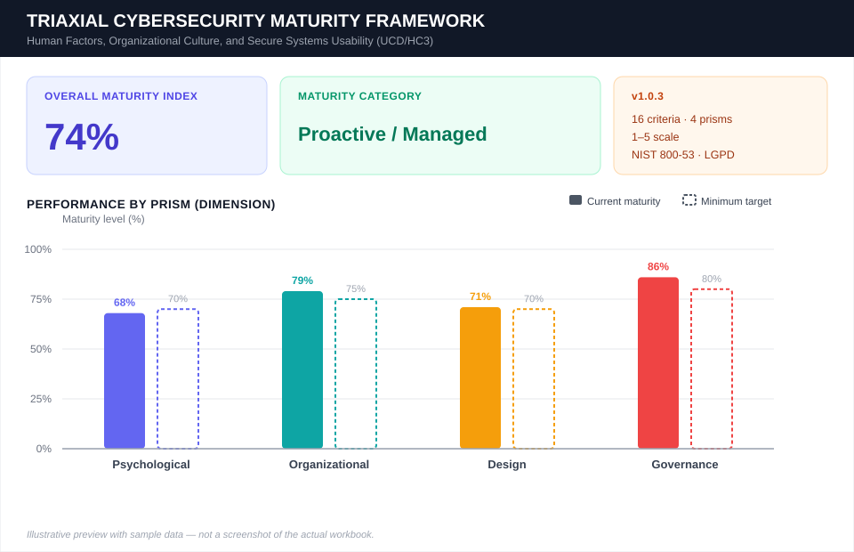

# 🛡️ Triaxial Cybersecurity Maturity Framework

<p align="left">
  
  
  
  
  <a href="https://doi.org/10.5281/zenodo.21986801"></a>
</p>

<p align="left">
  
  
  
  
</p>

**🌐 Read this in another language:** **English** · [Português (BR)](README.pt-BR.md) · [Español](README.es.md)

> **An auditable, quantitative instrument** for measuring cybersecurity maturity through the lens of the human factor, derived from the paper *"Human Factors in Cybersecurity: A Triaxial Analysis from the Psychological, Organizational, and Design Perspectives, with an Extended Governance-Oriented Maturity Assessment Instrument"* (Santos, Silva & Florindo, PPEE/UnB).

---

## 📖 About the Framework

Studies indicate that **more than 95%** of cyber incidents involve, at some level, human error or manipulation. Despite this, most organizations still measure their security posture in purely technical terms or through *reach metrics* (how many people "watched the training"), without any objective effectiveness metric.

This repository provides the spreadsheet **`cybersecurity-maturity-framework.xlsx`**, which operationalizes the **Triaxial Model** (Psychological, Organizational, and Design) described in the paper, extended with a **fourth prism — Governance and Compliance** (NIST SP 800-53 and LGPD), resulting in an instrument with **16 evaluation criteria, grouped into 4 dimensions**, with weights and weighted formulas that generate an **Overall Maturity Index (Imat)** and an automatic organizational classification.

| Prism | Focus | Key Reference |
|---|---|---|
| 🧠 **Psychological** | Amygdala hijacking, automation bias, digital literacy, phishing | Hadlington (2017); Hagen et al. (2025); Anwar et al. (2017) |
| 🏢 **Organizational** | Knowledge–behavior paradox, CTI-based CSA effectiveness, integrated intelligence, incident notification | Georgiadou et al. (2022); Silva et al. (2025) |
| 🎨 **Design** | HC3 framework, cognitive load, security by design, BYOD/Shadow IT governance | Cristiano & Spadafora (2024); Gutzwiller & Van Bruggen (2021) |
| ⚖️ **Governance and Compliance** | NIST SP 800-53 controls, LGPD principles, CTIR Gov notification, OSINT anti-fraud | NIST SP 800-53 Rev. 5; LGPD (Law No. 13.709/2018) |

---

## 🖼️ Dashboard Preview

<p align="center">
  
</p>

<p align="center"><sub>Illustrative mockup with sample data reproducing the actual layout of the <code>Dashboard</code> sheet — Overall Maturity Index, Maturity Category, and the per-prism performance chart. Not a literal screenshot of the workbook.</sub></p>

---

## 🗂️ Spreadsheet Structure

The workbook has **4 sheets**:

### 1. `Dashboard` — Executive Panel

| Cell | Content | Formula |
|---|---|---|
| `A5:B6` | **Overall Maturity Index** | `=Assessment!H21/Assessment!I21` |
| `C5:D6` | **Maturity Category** (dynamic verdict) | `=IF(A5<0.4,"Vulnerable / Critical", IF(A5<0.6,"Reactive / Basic", IF(A5<0.8,"Proactive / Managed","Resilient / Optimized")))` |
| `F4:I8` | Reference table describing each maturity band | static |
| `A9:C13` | **Performance by Prism**, computed via `SUMIF` over the `Assessment` sheet, compared against the recommended minimum target per dimension | `=SUMIF(Assessment!$B$5:$B$20, "<Prism>", Assessment!$H$5:$H$20) / SUMIF(...!$I$5:$I$20)` |
| — | Native column chart comparing **current maturity vs. minimum target** per prism | Excel Chart |

### 2. `Assessment` — Data Entry (16 criteria)

| Column | Name | Description |
|---|---|---|
| A | ID | Criterion identifier (`PS-01`…`GO-04`) |
| B | Analysis Prism | Dimension the criterion belongs to |
| C | Metric / Requirement | What is being evaluated |
| D | Scientific Reference | Author/year underpinning the criterion |
| E | Evidence & Evaluation Criteria | Operational description of what to observe/audit |
| **F** | **Score (1–5)** | 🔵 **Only editable column** — score assigned by the assessor |
| G | Weight (1–3) | Weight of the criterion within its dimension |
| H | Weighted Score | `=F*G` |
| I | Max Score | `=G*5` |
| J | Progress | `=H/I` (% maturity of the criterion) |
| 21 | **TOTALS & AVERAGES** | `F21=AVERAGE(F5:F20)` · `G21=SUM(G5:G20)` · `H21=SUM(H5:H20)` · `I21=SUM(I5:I20)` · `J21=H21/I21` |

> 🔒 **Data validation:** the range `F5:F20` accepts **only whole numbers from 1 to 5**. Any other value is rejected by the built-in `dataValidation` rule, with the message *"The entered score must be a whole number from 1 to 5."*

### 3. `Independent_Assessment` — Independent Multi-Rater Assessment *(new in v1.0.1)*

Each of the 3 raters (co-authors) scores every criterion **independently and before comparing answers** — either for **the same organization** (consensus) or for **three different organizations**, one per rater (comparison; the mode is chosen in `Control_Panel`) — based on real evidence of the process described by the guiding question, and records the observed evidence next to the score. Criteria that cannot be assessed with real evidence are left blank.

| Column | Name | Description |
|---|---|---|
| A–C | ID · Prism · Criterion | Same 16 criteria as `Assessment` |
| D | Guiding Question (what to check) | What evidence the rater must look for |
| E | Weight (w_i) | Same weights as `Assessment` |
| **F, H, J** | **Score – Rater 1/2/3** | 🔵 Editable — whole number 1–5 or blank |
| **G, I, K** | **Evidence/Justification – Rater 1/2/3** | 🔵 Editable — what was actually observed (no end-user personal data) |
| L | Mean Score | `=IF(COUNT(F,H,J)=0,"",AVERAGE(F,H,J))` |
| M | Range (Max−Min) | `=MAX(F,H,J)-MIN(F,H,J)` — since each rater assessed a different institution, a large range reflects real cross-institutional heterogeneity (a finding in itself), not rater disagreement to be resolved |
| N | Weighted Mean Score | `=L*E` |
| 21 | **TOTALS** | `E21=SUM(E5:E20)` · `L21`/`M21` = averages of the mean scores and ranges |
| 22 | **Multi-rater Maturity Index (I_mat, %)** | `N22=SUM(N5:N20)/(5*E21)*100` |
| 25–30 | **Per-Organization Maturity Index** *(new in v1.0.2)* | `D27:D29` = weighted index of each organization (Org. A/B/C), ignoring blank criteria: `=SUMPRODUCT(F5:F20,$E$5:$E$20)/(5*SUMPRODUCT(--(F5:F20<>""),$E$5:$E$20))*100` · `E27:E29` = maturity category · `D30` = cross-organizational mean (reference only) |

### 4. `Control_Panel` — Real-Data Control Panel *(new in v1.0.3)*

A mode switch in cell **`B4`** (drop-down list) selects how the `Independent_Assessment` data is read. Only the block matching the selected mode shows numbers; the other shows `—` and is greyed out by conditional formatting.

| Range | Content |
|---|---|
| `B4` | **Assessment mode** — `Same Organization (Consensus)` or `Different Organizations (Comparison)` |
| `A6:C14` | **Block 1 — Consensus** (same organization, three raters): overall index `B7 = Independent_Assessment!N22`, category, and per-prism index computed from the *Mean Score* column (L), against the minimum desired target |
| `A16:D25` | **Block 2 — Comparison** (three different organizations, one rater each): overall index and category of Org. A/B/C (`Independent_Assessment!D27:D29`) and per-prism index computed from each rater's score column (F, H, J) |
| `H20:K25` | Chart data (automatic — follows the mode in `B4`) |
| — | Native column chart **Maturity by Prism (selected mode)** |

---

## 📐 Overall Maturity Index Formula

$$
I_{mat} = \frac{\sum_{i=1}^{16} s_i \cdot w_i}{\sum_{i=1}^{16} 5 \cdot w_i} \times 100\%
$$

where `sᵢ ∈ {1,...,5}` is the score assigned to criterion *i* and `wᵢ` is the criterion's weight, per the criteria table below.

### 🚦 Maturity Classification

| Band | Category | Meaning |
|---|---|---|
| 🔴 `< 40%` | **Vulnerable / Critical** | High exposure to manipulation and severe process/design failures |
| 🟠 `40% – < 60%` | **Reactive / Basic** | Bureaucratic compliance with formal IT policy, low real engagement |
| 🟡 `60% – < 80%` | **Proactive / Managed** | Active monitoring via intelligence and user-centered interfaces |
| 🟢 `≥ 80%` | **Resilient / Optimized** | Integrated resilience culture, native compliance, security by design |

---

## 📋 The 16 Evaluation Criteria

<details>
<summary><b>🧠 Psychological Prism</b> (click to expand)</summary>

| ID | Criterion | Weight |
|---|---|:---:|
| `PS-01` | Control of amygdala hijacking | 3 |
| `PS-02` | Attenuation of automation/confirmation bias | 2 |
| `PS-03` | Self-efficacy & digital literacy | 2 |
| `PS-04` | Phishing susceptibility | 3 |

</details>

<details>
<summary><b>🏢 Organizational Prism</b></summary>

| ID | Criterion | Weight |
|---|---|:---:|
| `OR-01` | Knowledge–behavior paradox | 2 |
| `OR-02` | CSA effectiveness/resilience via CTI | 3 |
| `OR-03` | Integrated intelligence process | 2 |
| `OR-04` | Agile incident notification | 2 |

</details>

<details>
<summary><b>🎨 Design Prism</b></summary>

| ID | Criterion | Weight |
|---|---|:---:|
| `DS-01` | Use of the HC3 framework | 3 |
| `DS-02` | Cognitive load & authentication friction | 2 |
| `DS-03` | Security by Design & human control | 2 |
| `DS-04` | BYOD & Shadow IT governance | 1 |

</details>

<details>
<summary><b>⚖️ Governance and Compliance Prism</b></summary>

| ID | Criterion | Weight |
|---|---|:---:|
| `GO-01` | NIST SP 800-53 governance controls (PM/AC/CA) | 3 |
| `GO-02` | NIST SP 800-53 detect/respond controls (AU/PT/IR/CP) | 3 |
| `GO-03` | LGPD privacy principles | 2 |
| `GO-04` | OSINT shielding & fraud mitigation | 1 |

</details>

---

## 🚀 How to Use

Filling in the workbook is simple, practical, and fully automated. All calculation logic is already built into formulas, so you only need to enter your assessment scores (the sheets are not password-protected — just don't edit the formula cells).

### Step 1 — Open the `Assessment` sheet

Open `cybersecurity-maturity-framework.xlsx` in Excel, LibreOffice Calc, or Google Sheets, and go to the **`Assessment`** sheet (second tab). All data entry happens there.

> **Note:** The **`Dashboard`** sheet (first tab) is **read-only** — it automatically displays the charts and consolidated final results.

### Step 2 — Score the 16 criteria (Column F)

On the `Assessment` sheet you'll find 16 rows of technical criteria split across the four prisms (Psychological, Organizational, Design, and Governance). For each criterion, go to **Column F (Score)** and enter a whole number from **1 to 5**, based on the organization's current maturity under the following parameters:

| Score | Level | Description |
|:---:|---|---|
| **1** | Very Weak / Critical | The control is nonexistent, or there are severe security failures. |
| **2** | Weak | The process is reactive (ad hoc), carried out only when incidents occur, and is undocumented. |
| **3** | Intermediate | The control is partially implemented, formalized, and monitored at a basic level. |
| **4** | Good | The process is fully implemented, integrated into the operational routine, and actively monitored. |
| **5** | Leader / Resilient | The process is continuously optimized based on threat data (CTI), tested through simulations, and audited on a recurring basis. |

> ⚠️ **Data validation:** Column F carries a data-validation rule — the spreadsheet automatically rejects any value that isn't a whole number from 1 to 5, preventing accidental entry errors.

### Step 3 — Don't edit the formulas (Columns H, I, and J)

As you enter scores in column F:

- **Column H (Weighted Score)** dynamically calculates your score multiplied by the criterion's weight (Column G).
- **Column J (Progress)** shows that individual criterion's percentage of compliance.

Do not edit these columns — doing so breaks the underlying math.

### Step 4 — Review the Executive Dashboard

After scoring all 16 criteria on `Assessment`, go back to `Dashboard`. It instantly computes:

- The **Overall Maturity Index ($I_{mat}$)** (cells `A5:B6`).
- The **Maturity Category** (cells `C5:D6`): automatic classification into *Vulnerable/Critical*, *Reactive/Basic*, *Proactive/Managed*, or *Resilient/Optimized*.
- The **Performance by Prism** table: shows which dimension is furthest from its recommended minimum target (Psychological, Organizational, Design, or Governance).
- The **bar chart**: updates the current-performance columns against the established minimum targets, making it easy to visually present bottlenecks in reports or meetings.

Reapply the assessment periodically (e.g., semi-annually) to track the index's evolution over time.

> ⚠️ Do not edit columns `H`, `I`, and `J` — they contain formulas calculated automatically from the score (`F`) and the weight (`G`).

### Step 5 — (Optional) Independent multi-rater assessment

To reduce single-assessor bias, use the **`Independent_Assessment`** sheet (third tab). Each of the three raters fills in **only their own columns** — score (`F`, `H` or `J`, whole number 1–5 or blank) and the matching evidence/justification (`G`, `I` or `K`) — guided by the question in column `D`, **before comparing answers**. Columns `L`–`N`, the totals (rows 21–22), and the per-organization table (rows 25–30) are calculated automatically.

### Step 6 — Review the real-data `Control_Panel`

In the **`Control_Panel`** sheet (fourth tab), pick the mode in cell **`B4`**:

- **`Same Organization (Consensus)`** — the three raters assessed the same organization; Block 1 shows the consensus index (mean of the three scores) and the per-prism index against the minimum target.
- **`Different Organizations (Comparison)`** — each rater assessed a different organization; Block 2 shows the index, category, and per-prism index of Org. A, B, and C side by side.

The chart **Maturity by Prism (selected mode)** follows the chosen mode automatically.

---

## 🔬 Scientific Foundation

The framework operationalizes, among others, the following models cited in the original paper:

- **CTI-based CSA effectiveness model** (Silva et al., 2025) — underpins criterion `OR-02`, cross-referencing training participation with real credential-exposure data.
- **HC3 framework** (Cristiano & Spadafora, 2024) — underpins criterion `DS-01`, with the 8 user-centered design stages for cryptographic systems.
- **17 human factors in cybersecurity** (Rohan et al., 2021) — underpin the criteria of the Psychological prism.
- **NIST SP 800-53 Rev. 5** and **LGPD (Law No. 13.709/2018)** — underpin the fourth, Governance prism.

## 🔬 Scientific Rigor, Scope, and Future Work (v1.0.3)

This framework was designed through a rigorous methodological synthesis of the human-factors-in-cybersecurity literature. As an Open Science project in its initial version (v1.0.3), its scope of application is bounded by the following academic parameters, which are already being addressed on our research roadmap:

1. **Weight Validation and Calibration**: The current assignment of weights ($w_i$) reflects the authors' qualitative and theoretical synthesis based on the reviewed literature. Large-scale empirical testing and expert panels (Delphi Method) are planned to refine and statistically calibrate these coefficients.
2. **Literature Representativeness**: The framework's conceptual foundation prioritized high-relevance, indexed international journals and conferences (predominantly Western in scope). Future expansions will map the cultural and behavioral nuances specific to critical infrastructure in the Global South.
3. **Causality Analysis**: The current instrument provides a point-in-time snapshot of maturity. Future longitudinal studies are needed to establish long-term causal correlations between the evolution of the Overall Maturity Index ($I_{mat}$) and the reduction of real incidents.

## 📌 Citing This Work / Long-Term Archival

This repository is versioned and permanently archived on **[Zenodo](https://zenodo.org)** (free, CERN-backed), which mints a stable **DOI** for every release — unlike a plain GitHub link, a DOI cannot be moved, renamed, or deleted, making it the appropriate reference for a paper's methodology section.

[](https://doi.org/10.5281/zenodo.21986801)

> **DOI:** [10.5281/zenodo.21986801](https://doi.org/10.5281/zenodo.21986801)

**BibTeX:**

```bibtex
@software{santos_triaxial_framework,
  author    = {Santos, Karol Jozef Oliveira and Silva, Daniel Alves da and Florindo, Luiz Gustavo Marques},
  title     = {{Triaxial Cybersecurity Maturity Framework}},
  doi       = {10.5281/zenodo.21986801},
  url       = {https://doi.org/10.5281/zenodo.21986801}
}
```

---

<p align="center">
  <sub>Based on Santos, K. J. O.; Silva, D. A.; Florindo, L. G. M. — Professional Graduate Program in Electrical Engineering (PPEE), University of Brasília (UnB).</sub>
</p>
